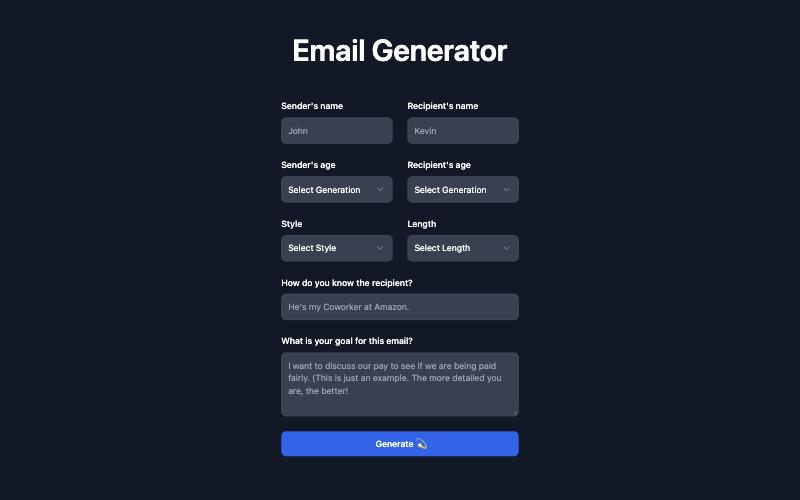

# GPT box

A small set of GPT tools I built in spring 2023, about two weeks after OpenAI opened the ChatGPT API (`gpt-3.5-turbo`). It's no longer maintained; I keep it here as an early project.

## What it did

- **Email generator.** Writes an email from who's sending it, who it's for, the tone, the length and the goal. A separate GPT call checks the inputs first and explains what's missing.
- **Pitch builder.** Drafts a Shark Tank-style pitch for a business idea one section at a time, each with its own prompt, streamed in as it's written.
- **Name generator.** Suggests business names and checks whether the .com, .net and .org are free through the name.com API.

## Stack

SvelteKit, TypeScript, Tailwind and Flowbite. The OpenAI API, streamed to the browser with server-sent events. Prisma. Deployed on Vercel.

The commit history is the original from 2023, moved to this repo in 2026.
